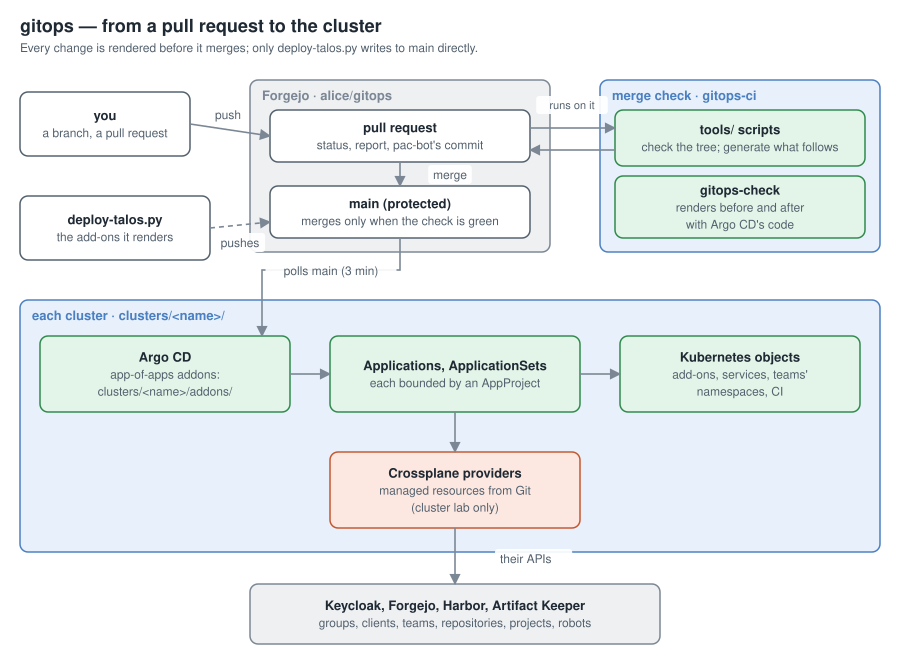

# Architecture

> Explanation · [Documentation](../../README.md#documentation)

How this repository becomes what runs on the clusters, and why it is laid out
the way it is. Where things are: [Repository layout](../reference/layout.md).

## One root per cluster

Each cluster has a folder, `clusters/<name>/`, and one root Application,
`addons`, that syncs `clusters/<name>/addons/` recursively. Everything else is
an Application or ApplicationSet in that folder, so the repository alone holds
the cluster's whole Argo CD view: the app-of-apps even lists itself. A
rebuilt Argo CD points at the folder and finds everything again.

## Two writers

The add-ons the cluster is built on (Argo CD, Cilium, cert-manager, the
gateway, Longhorn, monitoring, ...) are described in the cluster file of
deploy-talos.py (talos-install), not here. deploy-talos.py renders them into
`addons/generated/` and `generated/<topic>/`, marked `Generated by
deploy-talos.py`, and pushes them to `main` itself, with its deploy key.
Everything else is written by hand, through pull requests.

The split follows who knows what. deploy-talos.py knows the cluster's shape
(addresses, nodes, host names, OIDC clients) because it built the cluster;
the platform's services, teams and CI are this repository's business.
`generated/CHECKSUMS` and `tools/generated.py` keep the line clean: a hand
edit of a generated file fails the merge check instead of being silently
overwritten on the next run.

## Shared bases, thin overlays

Hand-written content shared by clusters lives in `base/` (no cluster names);
each cluster folder adds overlays that include a base and patch what differs:
host names, URLs, and that cluster's encrypted Secrets. A second cluster is a
second folder, not a copy of the manifests.

## Data, not manifests

Where the platform does the same thing many times, the repository holds
**data** and a chart or ApplicationSet turns it into objects:

- `applications/` describes organizations, teams and environments; the
  ApplicationSets in `addons/teams.yaml` iterate it
  ([Multi-tenancy](multi-tenancy.md)).
- `clusters/<name>/ci/<name>/repository.yaml` describes a platform CI
  repository; the ApplicationSet `ci-repositories` renders each with
  `base/ci-repository`.

Adding a team or a CI repository is then a small file, reviewable at a
glance, and every instance looks the same. What an ApplicationSet can't
derive (namespace lists, keys, random secrets) is generated by `tools/`
scripts and checked by the merge check.

## External objects as Kubernetes objects

Keycloak clients and groups, Forgejo organizations, teams, repositories and
users, Harbor projects and robots, Artifact Keeper repositories: all of them
are Crossplane objects in this repository, next to what uses them. A team's
whole footprint, in the cluster and outside, comes and goes with its folder.
Ansible only bootstraps the services themselves. See [Crossplane](crossplane.md).

## Changes through pull requests

`main` changes only through pull requests that pass the merge check, which
renders the repository before and after the change and blocks on errors
([Rendering before merging](merge-checks.md)). The only direct writer is deploy-talos.py,
whose output is checked against its own checksums.

## Bounds

Every Application belongs to an AppProject that limits where it may deploy
and what ([Bounded Applications](projects.md)); teams additionally deploy with their own,
namespace-scoped Argo CDs ([Multi-tenancy](multi-tenancy.md)).
