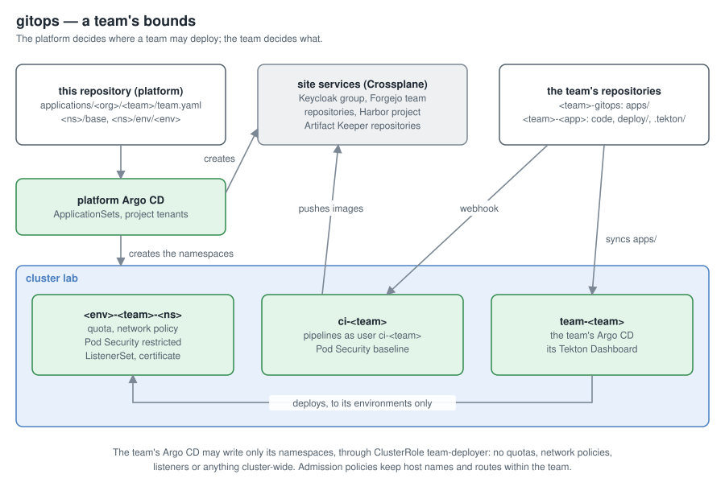

# Multi-tenancy

> Explanation · [Documentation](../../README.md#documentation)

How teams share the platform: what they control, what the platform keeps,
and why. To see it in practice: [Onboard a team](../tutorials/onboard-a-team.md).
The details: [What a team gets](../reference/team-resources.md),
[Team namespaces](../reference/team-namespaces.md).

## Two sides

| Who | Where | Decides |
|---|---|---|
| platform admins | this repository, `applications/` (pull requests) | organizations, teams, members, repositories, namespaces, host names, quotas |
| a team | its own repositories (`<org>/<team>-*`) | its applications' code and manifests, and which of them its Argo CD deploys |

The platform decides *where* a team may deploy; the team decides *what*. A
team never needs a pull request here to ship a new version, and the platform
never needs access to a team's repositories to change its bounds.

## A team's own Argo CD

Each team gets an Argo CD of its own in `team-<team>`, installed
namespace-scoped. Its root Application syncs `apps/` of `<team>-gitops`, so
the team adds applications with a commit to its own repository. It may deploy
only to `team-<team>` and the team's environment namespaces, and read only
the team's repositories (a credential template for `<org>/<team>-*`).

A team Argo CD instead of Applications in the platform's: a mistake in a
team's repository stays inside that team's bounds, the platform's Argo CD
holds no team content, and teams get the full Argo CD UI on what is theirs.

## Environments as namespaces

An application's environments are namespaces `<env>-<team>-<ns>`, each built
from the application's base (`<ns>/base/`) with the environment's overlay
(`<ns>/env/<env>/`, an ordinary kustomize overlay of `../../base`). The base comes
from `base/team-namespace`, so every environment starts with the same
guardrails: a quota, default container resources, Pod Security `restricted`,
a network policy that only lets the namespace itself, the ingress gateway
and Prometheus in. The team's Argo CD manages workloads there through
ClusterRole `team-deployer`, which leaves out exactly those guardrails
(quotas, limit ranges, network policies) and anything cluster-scoped.

## Host names without a shared file

Host names belong to teams, but the ingress gateway is shared. Each
environment gets a ListenerSet of its own with its own certificate, and two
admission policies keep it honest: `team-listeners` lets a team claim only
host names starting with its own prefix, `team-routes` lets a route attach
only to a ListenerSet in its own namespace. No team can answer for another's
host name, and no shared Gateway file has to change for a new one.

## CI as the team, not as the platform

Pipelines-as-Code runs a team's pipelines in `ci-<team>`, as the team's own
Forgejo user `ci-<team>`, never as the platform's `pac-bot`: a run's token
reaches the team's repositories and nothing else. Making those users requires
Crossplane's Forgejo account to be a site admin, a large grant, so two
admission policies bound what Crossplane may create in the cluster:
`forgejo-users` (only `ci-*` users, never admins, only CI token scopes, and in
a team's namespaces only that team's) and `team-forgejo` (a team's Forgejo
objects stay within its own repositories and team, by reference, not ID).
The bound is in the cluster because that is where the requests come from.

## One file per team, three Applications

A team's platform objects come from one chart, rendered as three
Applications by duty: core (namespace, groups, repositories, the root
Application), CI (CI namespace, user, webhooks, Dashboard) and packages
(Harbor project and robot, Artifact Keeper repositories). Each has its own
sync status and diff, so a waiting Artifact Keeper permission doesn't mark
the whole team unhealthy, and a CI change shows as a CI change.

## What outlives a team

Removing a team removes what lives in the cluster and the access it had:
namespaces, its Argo CD, memberships, deploy keys, the CI user and
webhooks. What holds the team's work stays: Keycloak groups and clients,
the Forgejo team and repositories, the Harbor project, the Artifact Keeper
repositories. Crossplane never deletes those (no `Delete` policy), because a
folder removed by mistake must not destroy code or images. Removing them is a
deliberate, manual act.

## Removing a team

A team goes in two changes, `removed: true` in its `team.yaml`, then its
folder, for two reasons that both come from deleting things in the right
order.

The `tenants` project lists the team's namespaces, generated from the
folder. Deleting the folder at once would remove them from the project in
the same change as the team's Applications; when Argo CD applies the project
first, it treats the Applications as outside their bounds and drops them
without deleting what they made. With `removed: true` the ApplicationSets
drop the team while the project still permits its namespaces, so the
deletion is complete; the folder, and the namespaces in the project, go
afterwards.

Crossplane's objects live in `team-<team>` and `ci-<team>`, and deleting an
external object needs the object's namespace to still exist (Crossplane
records a usage there first). So Argo CD doesn't delete those two namespaces
(`Delete=false`), nor the CI user's password (Secret `forgejo-bot`), which
Crossplane needs to sign in as that user and delete its token; a small cleanup job (`base/namespace-cleanup`) deletes them
once no Application of the team is left and no Crossplane object remains in
them. Environment namespaces opt into the same job, in case an environment's
folder is deleted on its own and races the same way.

## Bounds of the platform's own Argo CD

The ApplicationSets that render teams run in the platform's Argo CD under
the AppProject `tenants`, which lists every namespace of the tree and every
kind the team chart uses. A bad `team.yaml` can't create anything outside
those ([Bounded Applications](projects.md)).
